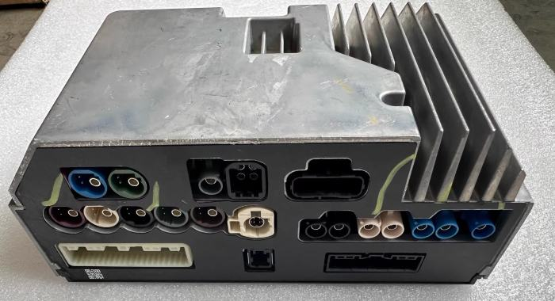

Головное устройство (блок мультимедиа) работает на `Android` с фирменной оболочкой `DiLink`.

Как правило, блок мультимедиа расположен в туннеле между водителем и передним пассажиром. Нужно снять пластик с двух сторон, открутить болты, отсоединить коннекторы, достать и разобрать блок. У некоторых автомобилей блок находится под передним пассажирским сиденьем.



Для перезагрузки ГУ необходимо несколько секунд удерживать кнопку громкости на центральной панели.

Сбросить ГУ к заводским настройкам можно в меню `Settings > DiLink > General > Factory reset` либо через [recovery](/docs/head-unit/recovery).


## Частые проблемы

### Не работает навигация / микрофон

Нет разрешения на работу GPS, микрофона и др. Они выдаются максимум на 1 год. См. в меню `Settings > DiLink > General > Apps > Privacy`.


### "Глючит" Яндекс Навигатор

В Яндекс Навигаторе машина "висит" на одном месте либо двигается рывками. Решение - использовать версию не выше `24.5.1`.


### Восстановление коннекта с телефоном по Bluetooth (для звонков и музыки) через ADB

**Проблема:** телефон перестал подключаться к Bluetooth автомобиля, хотя раньше всё работало. Возможная причина — какие-то глюки настроек Android после установки стороннего ПО. Диагностический признак: в Logcat возможны ошибки com.byd.btsetting, NullPointerException, HfpClientProfile и A2dpSinkProfile.

1. Проверить настройки Bluetooth-профилей

```sh
adb shell settings get global bluetooth_disabled_profiles
```
На неисправном автомобиле было значение `202803`.
Перед изменением обязательно сохрани исходное значение, чтоб вернуть всё обратно при необходимости.

2. Восстановить Bluetooth-профили

```sh
adb shell settings put global bluetooth_disabled_profiles 51
```

Значение `51` позволило запустить профили:
• A2DP Sink — музыка
• HFP Client — телефонные звонки
• PBAP Client — контакты
• AVRCP Controller — управление музыкой

3. Перезапустить Bluetooth через интерфейс DiLink: выключить Bluetooth и включить обратно.
4. Проверить запуск профилей

```sh
adb shell dumpsys bluetooth_manager
#  В выводе должны присутствовать:
#Profile: A2dpSinkService
#Profile: HeadsetClientService
#Profile: AvrcpControllerService
#Profile: PbapClientService
```

5. Переподключить телефон - удалить старое сопряжение и выполнить новое. Проверить музыку и звонки.
6. Полностью перезагрузить мультимедиа и проверить:

```sh
adb shell settings get global bluetooth_disabled_profiles
```
Ожидаемое значение: `51`
Убедиться, что телефон повторно подключается автоматически.

Откат изменений:

Для автомобиля, на котором исходное значение было `202803`:

```sh
adb shell settings put global bluetooth_disabled_profiles 202803
```
Затем выключить и снова включить Bluetooth.


Значение `51` успешно восстановило работу Bluetooth на конкретном BYD с DiLink 5. Оно не является подтверждённым универсальным заводским значением для всех автомобилей BYD. На других машинах сначала проверять исходную конфигурацию. После изменения дополнительно проверить работу BLE-ключей, если они используются.

