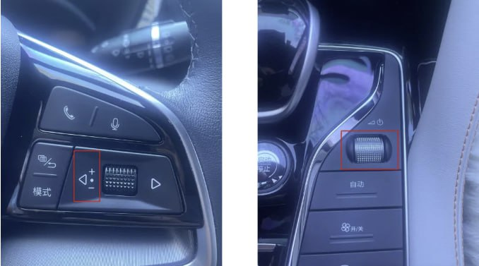
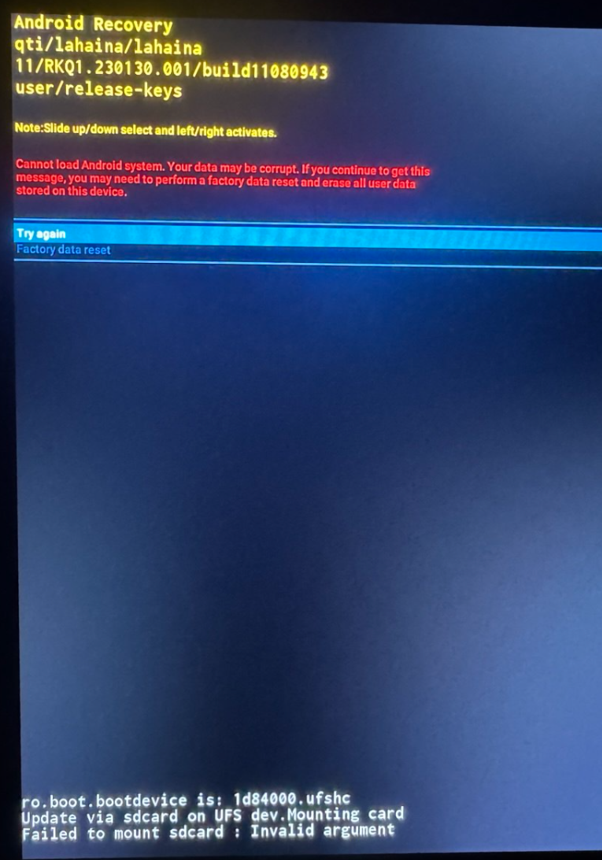

## Recovery


Раздел нуждается в дополнении


**Recovery mode** - специальный режим загрузки Android-устройства, который работает отдельно от основной операционной системы.

Вход в режим **recovery**: одновременно зажать и подержать 6 секунд кнопку "влево" на руле и громкость на центральной панели

Навигация осуществляется путем свайпов вниз/вверх и вправо.

## Прошивка ГУ

- Подготовить USB-флешку с файлом прошивки согласно [инструкции](/docs/head-unit/firmware). Флешка должна быть отформатирована в **NTFS**.
- Достать microSD-карту, вставить флешку в USB-разъем
- Зажать 2 кнопки одновременно (см. выше) на 6 секунд, ГУ перезагрузится и прошивка начнется автоматически.
